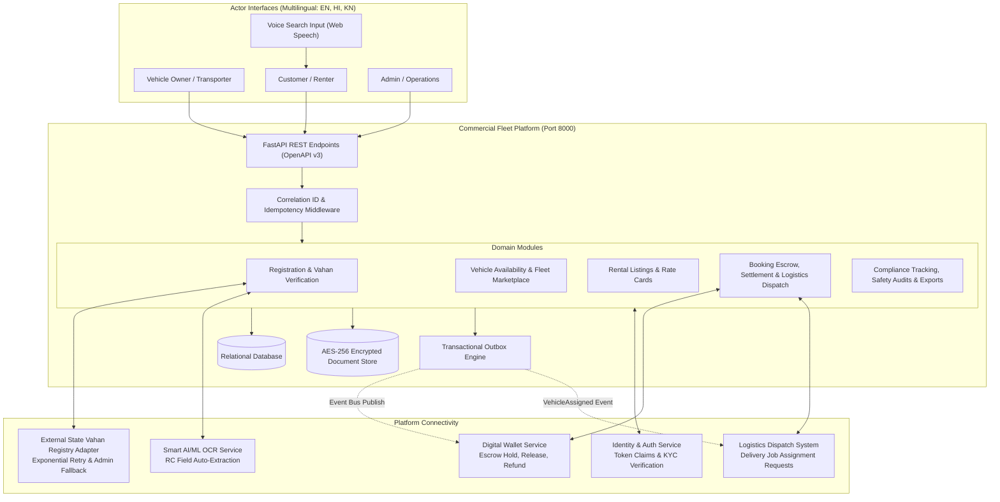
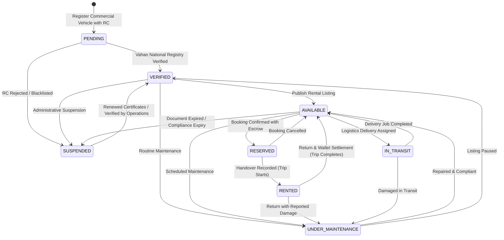
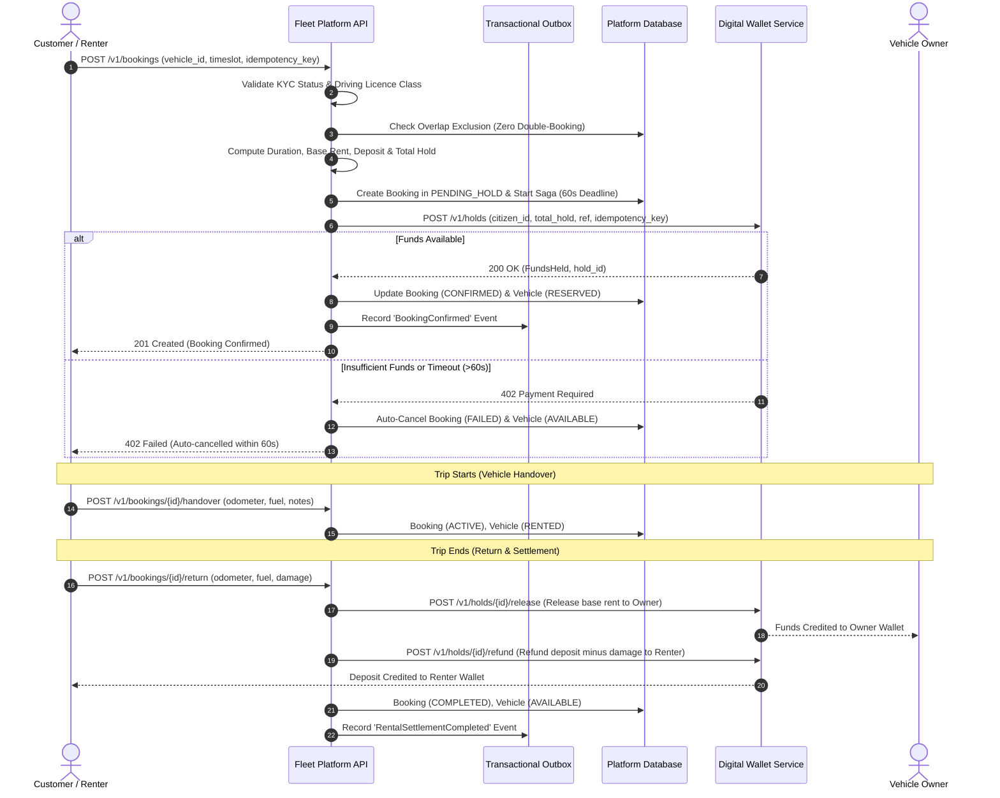

# AgriLink Commercial Fleet & Logistics Platform
## System Architecture & Technical Specification
**Ecosystem:** AgriLink · **Platform Service:** Commercial Fleet & Logistics · **Version:** 1.0.0

---

## 1. System Architecture Overview
The **Fleet & Logistics Service** is an independently deployable platform service within the AgriLink commerce ecosystem. It handles vehicle registration, RC document verification against national registries, rental listing and rate cards, fleet availability search, rental bookings with digital wallet escrow sagas, assignment of vehicles to AgriLink delivery jobs, and compliance tracking.

---

## 2. Vehicle Lifecycle State Machine
The lifecycle of every registered vehicle strictly adheres to the state transitions below:

---

## 3. Booking Escrow Saga & Automated Settlement

---

## 4. Key Architectural Standards
- **Zero Double-Booking Guarantee:** Atomic database range overlap verification on confirmed time slots.
- **Digital Wallet Escrow:** Real-time fund hold before booking confirmation with automated timeout cancellation.
- **Registry Outage Resilience:** Asynchronous retry queue with exponential back-off and administrative review queue.
- **Enterprise Security:** JWT-based stateless authentication, role authorization, and AES-256 envelope document encryption.
- **Event-Driven Outbox:** Transactional outbox engine ensuring reliable cross-system message delivery.
- **Multilingual Localization:** Dynamic English, Hindi (हिंदी), and Kannada (ಕನ್ನಡ) dictionary with browser voice recognition.
